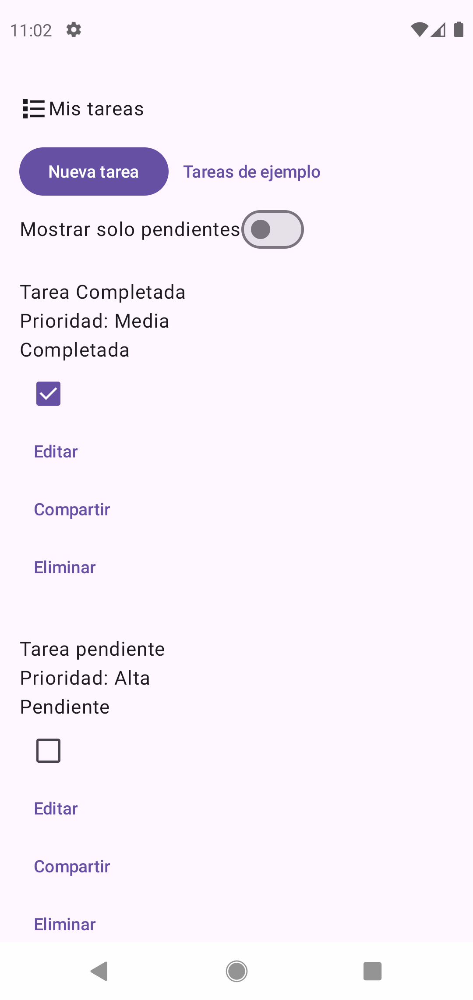
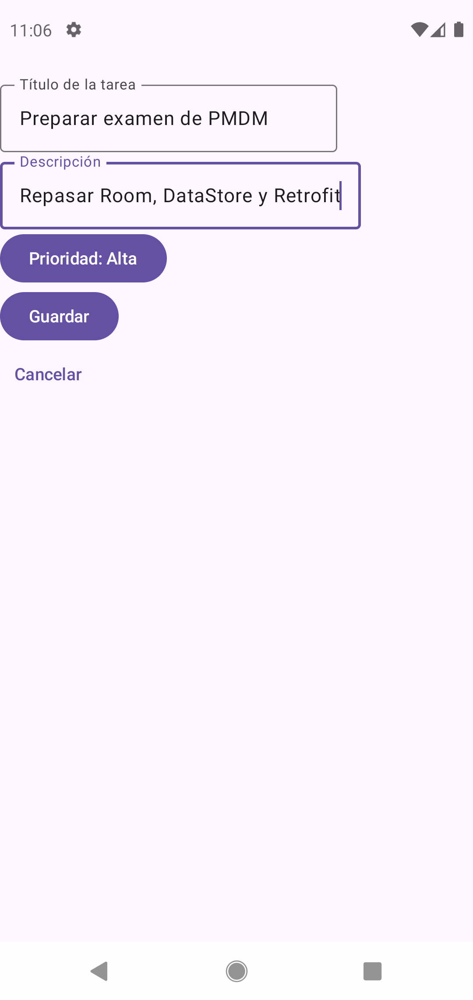
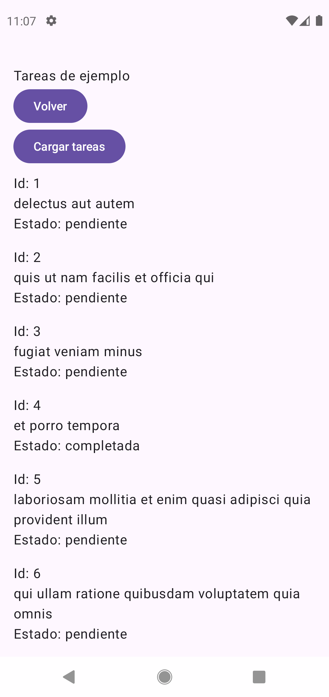
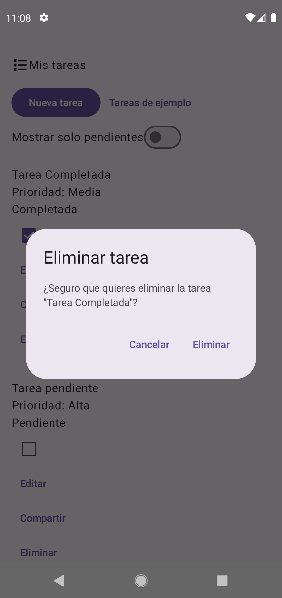

# Gestor Personal de Tareas

Aplicación Android desarrollada como práctica de Programación Multimedia y Dispositivos Móviles de 2.º de DAM.

Permite gestionar tareas personales, conservarlas entre ejecuciones, guardar una preferencia de visualización, consultar tareas de ejemplo por Internet y compartir tareas con otras aplicaciones.

## Funcionalidades

- Crear tareas con título, descripción y prioridad.
- Validar que el título tenga al menos tres caracteres después de eliminar los espacios exteriores.
- Seleccionar una prioridad: Baja, Media o Alta.
- Editar tareas existentes.
- Cambiar su estado entre pendiente y completada.
- Eliminar tareas mediante un diálogo de confirmación.
- Conservar las tareas mediante Room.
- Filtrar las tareas pendientes y conservar la preferencia mediante DataStore.
- Consultar tareas de ejemplo de JSONPlaceholder mediante Retrofit.
- Mostrar el estado de carga, los errores de conexión y una opción de reintento.
- Compartir el título, la descripción y la prioridad mediante el selector de aplicaciones.
- Adaptar la distribución del listado a pantallas compactas y grandes.

Las tareas de ejemplo se muestran en un apartado separado y no se incorporan a la base de datos personal.

## Tecnologías y bibliotecas

- Kotlin.
- Jetpack Compose y Material 3: interfaz de usuario.
- Room: almacenamiento de tareas.
- KSP: generación del código necesario para Room.
- Preferences DataStore: almacenamiento del filtro.
- Retrofit y Gson: consulta y conversión de los datos de la API.
- Coroutines: operaciones asíncronas de almacenamiento y red.
- Gradle: configuración y compilación.

## Organización del proyecto

El código Kotlin se encuentra en:

`app/src/main/java/dev/example/gestortareas/`

| Archivo | Responsabilidad |
|---|---|
| MainActivity.kt | Pantallas de tareas personales, formulario y gestión de eventos. |
| Tarea.kt | Modelo y entidad Room de una tarea personal. |
| TareaDao.kt | Consultas, inserciones, actualizaciones y eliminaciones. |
| TareasDatabase.kt | Creación y acceso a la base de datos. |
| PreferenciasUsuario.kt | Lectura y escritura del filtro con DataStore. |
| TareaEjemplo.kt | Modelo de las tareas recibidas de la API. |
| TareasApi.kt | Definición de la petición HTTP. |
| ClienteApi.kt | Configuración de Retrofit. |
| PantallaTareasEjemplo.kt | Consulta y presentación de tareas de ejemplo. |
| CompartirTarea.kt | Preparación del texto y apertura del selector para compartir. |
| ui/theme/ | Colores, tipografía y tema de la aplicación. |

Otros archivos de entrega:

- `docs/images/`: capturas de pantalla.
- `apk/GestorPersonalTareas-debug.apk`: APK de depuración.

## Ejecución desde Android Studio

1. Clonar o descargar el repositorio.
2. Abrir la carpeta principal del proyecto en Android Studio.
3. Esperar a que termine la sincronización de Gradle.
4. Instalar los componentes del SDK solicitados, si faltan.
5. Iniciar un emulador o conectar un dispositivo compatible.
6. Seleccionar el módulo `app` y pulsar Run.

El proyecto tiene configurada una versión mínima de Android 7.0, API 24.

La consulta de tareas de ejemplo necesita conexión a Internet. Las tareas personales y su almacenamiento local pueden utilizarse sin conexión.

## Instalación del APK

El archivo de entrega está en:

[Descargar APK de depuración](apk/GestorPersonalTareas-debug.apk)

Para instalarlo en un emulador, arrastrar el APK hasta su pantalla y esperar a que termine la instalación. Después, abrir Gestor Personal de Tareas desde el menú de aplicaciones.

Se ha comprobado que el APK generado se instala, se ejecuta y conserva las tareas guardadas.

## Emuladores utilizados

| Configuración | Emulador compacto | Emulador de pantalla grande |
|---|---|---|
| Dispositivo | Pixel 4 | Pixel Tablet |
| Android | 11 | 16 |
| API | 30 | 36 |
| Arquitectura | x86 | x86_64 |
| Tipo de pantalla | Móvil | Tablet |

## Pruebas manuales

Las siguientes pruebas se han realizado manualmente en ambos emuladores.

| Nº | Prueba | Resultado esperado | Pixel 4 | Pixel Tablet |
|---|---|---|---|---|
| 1 | Crear una tarea válida | Se guarda y aparece una sola vez en el listado. | Correcto | Correcto |
| 2 | Guardar un título vacío | Se muestra un error y no se crea la tarea. | Correcto | Correcto |
| 3 | Editar una tarea | Se actualizan sus datos sin duplicarla. | Correcto | Correcto |
| 4 | Cambiar el estado | Puede completarse y volver a pendiente; el cambio se guarda. | Correcto | Correcto |
| 5 | Cancelar una eliminación | La tarea permanece sin cambios. | Correcto | Correcto |
| 6 | Confirmar una eliminación | La tarea desaparece y no reaparece al reiniciar. | Correcto | Correcto |
| 7 | Cerrar y abrir la aplicación | Se recuperan las tareas guardadas. | Correcto | Correcto |
| 8 | Activar el filtro y reiniciar | Se conserva la preferencia y aparecen solo las pendientes. | Correcto | Correcto |
| 9 | Consultar la API con Internet | Se muestran identificador, título y estado. | Correcto | Correcto |
| 10 | Consultar sin conexión y reintentar | Se informa del error y se permite repetir la consulta. | Correcto | Correcto |
| 11 | Compartir una tarea | Se abre el selector de aplicaciones compatibles. | Correcto | Correcto |
| 12 | Cambiar la orientación | La aplicación sigue funcionando y conserva los datos persistidos. | Correcto | Correcto |

También se ha comprobado que se rechazan los títulos formados solo por espacios y los de menos de tres caracteres.

## Capturas de pantalla

### Listado principal

### Formulario de creación

### Consulta a la API

### Confirmación de eliminación

## Uso de inteligencia artificial

Se ha utilizado ChatGPT como apoyo para comprender conceptos, revisar intentos de código, interpretar errores y organizar las comprobaciones y la documentación.

Las pruebas manuales descritas han sido realizadas por el alumno.

[Consultar el chat utilizado durante el desarrollo](https://chatgpt.com/share/6afa3d8b-ad9c-83ed-a645-6c2f86c762c6)

## Incidencias conocidas

No se han detectado incidencias pendientes durante las pruebas manuales descritas. Esto no garantiza la ausencia de errores en situaciones no probadas.